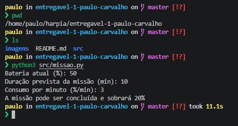

# Entregável 1 — Verificador de bateria para missão

**Autor:** Paulo Carvalho

## Objetivo

Programa em Python que verifica se um robô tem bateria suficiente para realizar uma missão, considerando consumo constante por minuto. O usuário informa:

- bateria atual (%, de 0 a 100);
- duração prevista da missão (minutos);
- consumo por minuto (pontos percentuais da bateria).

O programa calcula o consumo total (`duração × consumo por minuto`) e informa se a missão pode ser concluída. Se puder, mostra a bateria restante; se não, mostra quantos pontos percentuais faltam. Se a bateria estiver fora de 0 a 100, ou se a duração ou o consumo forem menores ou iguais a zero, o programa exibe uma mensagem de valor inválido e encerra.

## Requisitos

- Linux (ou Windows com WSL)
- Python 3

Observação sobre os tipos de entrada: os três valores devem ser informados como números inteiros. Antes de implementar, tirei a dúvida sobre a necessidade de aceitar valores decimais e confirmei que não era necessário. Por isso, o programa não considera float e não faz tratativa para entradas decimais: um valor como 0.5 não é aceito.

## Como executar

A partir da pasta principal do repositório:

```bash
python3 src/missao.py
```

## Exemplos

### Bateria suficiente

```
Bateria atual (%): 80
Duração prevista da missão (min): 10
Consumo por minuto (%/min): 3
A missão pode ser concluída e sobrará 50%
```

### Bateria insuficiente

```
Bateria atual (%): 20
Duração prevista da missão (min): 10
Consumo por minuto (%/min): 3
A missão não pode ser concluída! Faltam 10%
```

### Bateria exatamente igual ao consumo

```
Bateria atual (%): 30
Duração prevista da missão (min): 10
Consumo por minuto (%/min): 3
A missão pode ser concluída e sobrará 0%
```

### Valores inválidos

Bateria fora do intervalo de 0 a 100:
```
Bateria atual (%): 120
Duração prevista da missão (min): 10
Consumo por minuto (%/min): 3
A bateria deve estar entre 0 e 100
```

Duração ou consumo menor ou igual a zero:
```
Bateria atual (%): 50
Duração prevista da missão (min): 0
Consumo por minuto (%/min): 3
Duração e consumo por minuto não podem ser menores ou iguais a zero.
```

## Captura de tela

